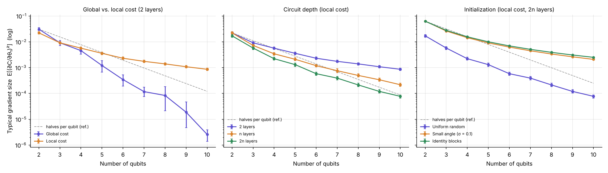

# Barren Plateau Explorer

[](https://github.com/avinashjeewani/barren-plateau-explorer/actions/workflows/ci.yml)
[](LICENSE)


**How fast do gradients vanish in quantum circuits as you add qubits, and which design choices stop it?**

Variational quantum circuits are trained with gradients. In many circuits, those gradients shrink *exponentially* as the number of qubits grows. This is called a **barren plateau**: the training landscape becomes so flat that no optimizer can find a direction to move. It is one of the main obstacles to scaling quantum machine learning.

This repo measures the effect directly, so you can see it rather than take it on faith. It sweeps 2 to 10 qubits and compares three design choices: the cost function, the circuit depth, and how parameters are initialized. The whole run takes about a minute on a laptop.



## Headline results

Going from 2 to 10 qubits, the typical gradient size E[(∂C/∂θ)²]:

| Setup | Gradient shrinks by | Behavior |
|---|---:|---|
| Global cost, shallow circuit | **11,991×** | exponential: about ×0.32 per added qubit |
| Local cost, deep circuit (2n layers), random init | **221×** | exponential: about ×0.57 per added qubit |
| Local cost, shallow circuit (2 layers) | **26×** | polynomial: ∝ n⁻²·⁰ |
| Local cost, deep circuit, **identity-block init** | **25×** | polynomial: ∝ n⁻²·⁰ |
| Local cost, deep circuit, **small-angle init** | **30×** | polynomial: ∝ n⁻²·¹ |

So the same deep circuit loses 221× of its gradient with random initialization but only 25× with identity blocks. And a shallow circuit loses 26× with a local cost but almost 12,000× with a global one.

## Background in one minute

A variational circuit has trainable rotation angles θ. You compute a cost C(θ) from measurements and update θ along the gradient ∂C/∂θ. Under random initialization the average gradient is zero, so what matters is how *big* it typically is, measured by the mean squared gradient E[(∂C/∂θ)²].

If that number decays like 2⁻ⁿ, then estimating a gradient to useful precision needs exponentially many measurement shots, and training stalls. Three results from the literature say when this happens:

1. **Deep random circuits have barren plateaus** (McClean et al., 2018).
2. **The cost function matters, even for shallow circuits** (Cerezo et al., 2021). A *global* cost, which checks all qubits at once, has an exponentially vanishing gradient. A *local* cost, which averages per-qubit checks, decays only polynomially if the circuit is shallow.
3. **Initialization matters** (Grant et al., 2019). If the circuit starts as the identity, the gradient at the start does not vanish exponentially.

This repo reproduces all three.

## What it measures

For every number of qubits n from 2 to 10, and for every configuration ("series"), it:

1. **Builds the circuit.** The circuit takes the input |+⟩ⁿ, then applies L layers of a hardware-efficient ansatz: an RY and an RZ rotation on every qubit, followed by a ladder of CZ gates.
2. **Draws 400 random initializations** using the series' init strategy.
3. **Computes the exact gradient** of the cost with respect to the first rotation angle, using the parameter-shift rule.
4. **Records E[(∂C/∂θ₁)²]** with a 95% bootstrap confidence interval.

It then fits two decay laws to each series (exponential in n, and polynomial n^k) and labels the decay as exponential only if that model fits better and the rate is meaningfully below 1.

### Cost functions

Both measure how far the output is from |0…0⟩ and lie between 0 and 1.

| Cost | Formula | What it checks |
|---|---|---|
| **Global** | C = 1 − P(all qubits read 0) | one all-or-nothing outcome |
| **Local** | C = 1 − (1/n) Σᵢ P(qubit i reads 0) | each qubit separately, averaged |

### Initialization strategies

| Strategy | How parameters are drawn |
|---|---|
| **Uniform random** | Every angle ~ U(0, 2π). The standard choice. |
| **Small angle** | Every angle ~ N(0, 0.1²), so the circuit starts close to the identity. |
| **Identity blocks** | The first half of the layers is random and the second half is its exact inverse, so the full circuit is exactly the identity at the start. |

### The three experiments

| Experiment | What varies | Fixed |
|---|---|---|
| `cost` | global vs. local cost | 2 layers, uniform init |
| `depth` | 2 layers vs. n layers vs. 2n layers | local cost, uniform init |
| `init` | uniform vs. small-angle vs. identity blocks | local cost, 2n layers |

## Full results

From [`results/summary.md`](results/summary.md), generated from [`results/gradients.csv`](results/gradients.csv) (72 measurements, 400 samples each). Fits use n ≥ 4.

| Experiment | Series | E[g²] at n=2 | E[g²] at n=10 | Drop | Exponential fit: rate per qubit (R²) | Power-law fit (R²) | Decay |
|---|---|---:|---:|---:|---:|---:|---|
| cost | Global cost | 3.09e-02 | 2.58e-06 | 11,991× | ×0.32 (0.976) | n^-7.5 (0.951) | **exponential** |
| cost | Local cost | 2.23e-02 | 8.62e-04 | 26× | ×0.74 (0.976) | n^-2.0 (0.998) | polynomial |
| depth | 2 layers | 2.23e-02 | 8.62e-04 | 26× | ×0.74 (0.976) | n^-2.0 (0.998) | polynomial |
| depth | n layers | 2.23e-02 | 2.17e-04 | 102× | ×0.63 (0.996) | n^-3.0 (0.993) | **exponential** |
| depth | 2n layers | 1.70e-02 | 7.72e-05 | 221× | ×0.57 (0.995) | n^-3.7 (0.989) | **exponential** |
| init | Uniform random | 1.70e-02 | 7.72e-05 | 221× | ×0.57 (0.995) | n^-3.7 (0.989) | **exponential** |
| init | Small angle (σ = 0.1) | 6.33e-02 | 2.09e-03 | 30× | ×0.73 (0.985) | n^-2.1 (1.000) | polynomial |
| init | Identity blocks | 6.25e-02 | 2.50e-03 | 25× | ×0.74 (0.983) | n^-2.0 (1.000) | polynomial |

The "2 layers" row of the depth experiment and the "Uniform random" row of the init experiment repeat configurations from other experiments, so they match exactly.

## Key findings

1. **Global costs create barren plateaus even in shallow circuits.** With only 2 layers, the global-cost gradient drops 11,991× from 2 to 10 qubits, about ×0.32 per qubit. That is faster than halving. The same circuit with a local cost drops only 26×.
2. **Depth turns a polynomial decay into an exponential one.** With a local cost, 2 layers give n⁻²·⁰ decay. With n or 2n layers, the decay becomes exponential (×0.63 and ×0.57 per qubit), and the 2n-layer circuit ends 11× smaller than the 2-layer one at n = 10.
3. **Starting at the identity avoids the plateau at initialization.** For the same 2n-layer circuit, identity-block and small-angle starts keep the gradient 32× and 27× larger at n = 10 than uniform random init, with polynomial rather than exponential decay.
4. **The remaining n⁻² decay is just the cost's 1/n averaging.** For identity blocks, the gradient is exactly 1/(2n), so E[g²] = 1/(4n²): 0.0625 at n = 2 and 0.0025 at n = 10, matching the measurements exactly. A unit test checks this analytically.

## Quick start

Requires Python 3.10 or newer.

```bash
git clone https://github.com/avinashjeewani/barren-plateau-explorer.git
cd barren-plateau-explorer
pip install -e ".[dev]"

make test        # unit tests (a few seconds)
make quick       # small run, 2–5 qubits (a few seconds)
make reproduce   # full run, 2–10 qubits (~1 minute); regenerates results/
```

Without `make`:

```bash
pytest -q
python -m bpx.experiments --config configs/default.yaml
python -m bpx.report results configs/default.yaml   # rebuild tables and chart from the CSV
```

## Configuration

Experiments are defined in [`configs/default.yaml`](configs/default.yaml). Each experiment is a set of named series, and each series picks a cost, a depth and an init. Depth can be a fixed number or scale with the qubit count (`"n"`, `"2n"`).

```yaml
qubits: {min: 2, max: 10}
n_samples: 400
experiments:
  cost:
    series:
      "Global cost": {cost: global, layers: 2, init: uniform}
      "Local cost":  {cost: local,  layers: 2, init: uniform}
```

To try something new, add a series or a whole experiment and rerun. For example, to push to 12 qubits, set `max: 12`. Expect each extra qubit to roughly double the runtime of the deepest series.

## Project structure

```
barren-plateau-explorer/
├── configs/
│   ├── default.yaml       # full run
│   └── quick.yaml         # smoke run (used in CI)
├── src/bpx/
│   ├── circuits.py        # ansatz, cost functions, init strategies, parameter-shift gradient
│   ├── experiments.py     # sweeps qubits for each series → gradients.csv
│   └── report.py          # decay fits → summary.md, and the three-panel chart
├── results/               # generated outputs (see results/README.md)
├── tests/test_circuits.py # gradient correctness, identity init, analytic 1/(2n) check
└── .github/workflows/ci.yml
```

## Implementation notes

- **Exact gradients.** RY gates have Pauli generators, so the parameter-shift rule [C(θ + π/2) − C(θ − π/2)] / 2 gives the exact derivative. A test compares it with finite differences.
- **Batched simulation.** All 400 initializations, plus both shifted copies, run as a single broadcast circuit call in PennyLane, which makes the full sweep fast.
- **Why E[g²] and not the variance.** Most papers report Var[∂C/∂θ]. Under uniform random init the mean gradient is zero, so the two are the same. But identity-block init is deterministic in its effect: every sample has the *same* gradient, 1/(2n), so its variance is zero even though the gradient is large. E[g²] measures gradient size correctly in both cases. Both columns are in the CSV.
- **Why the |+⟩ⁿ input.** If the circuit started from |0…0⟩, an identity circuit would already be at the cost's minimum, and every gradient would be exactly zero. Starting from |+⟩ⁿ gives the optimizer something to do, as in Grant et al.

## Limitations

- **Gradient at initialization only.** This measures where training *starts*. A good start does not guarantee the optimizer won't wander into a flat region later.
- **One parameter.** It measures the gradient of the first rotation angle. Parameters deeper in the circuit can behave differently, especially for shallow circuits, where each parameter only affects nearby qubits.
- **Up to 10 qubits.** Over this range, exponential and polynomial fits can both look reasonable (see the R² columns), so the verdicts for the n-layer circuit in particular are a close call. Larger n would separate them more clearly.
- **One ansatz, exact simulation.** Results are for this hardware-efficient ansatz without noise. Hardware noise can cause its own, noise-induced barren plateaus, which are not modeled here.
- **Small angles trade expressivity for gradient.** A circuit that starts near the identity has large gradients but also starts close to a trivial operation. That is often fine, but it is a trade-off, not a free fix.

## References

- J. R. McClean, S. Boixo, V. N. Smelyanskiy, R. Babbush, H. Neven. *Barren plateaus in quantum neural network training landscapes.* Nature Communications 9, 4812 (2018).
- M. Cerezo, A. Sone, T. Volkoff, L. Cincio, P. J. Coles. *Cost function dependent barren plateaus in shallow parametrized quantum circuits.* Nature Communications 12, 1791 (2021).
- E. Grant, L. Wossnig, M. Ostaszewski, M. Benedetti. *An initialization strategy for addressing barren plateaus in parametrized quantum circuits.* Quantum 3, 214 (2019).

## Contributing

Issues and pull requests are welcome, especially:

- other ansätze (e.g. `StronglyEntanglingLayers`, QAOA-style circuits)
- other mitigation strategies, such as layer-wise training or correlated parameters
- gradients of parameters other than the first
- noisy simulation, to show noise-induced barren plateaus

If you change the code or a config, please rerun `make reproduce` and commit the regenerated `results/`.

## Citation

Cite this repository using the metadata in [`CITATION.cff`](CITATION.cff); GitHub shows a "Cite this repository" button for it. Please also cite the original papers above.

## License

MIT. See [LICENSE](LICENSE).
